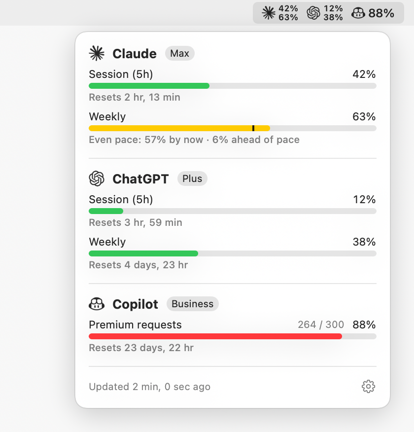

# Fuel Gauge

A tiny macOS menu bar app showing current plan usage for **Claude**, **ChatGPT** and **GitHub Copilot**.

<p align="center"></p>

- The menu bar shows the most-used limit per provider next to an icon for each service. When a limit hits 100%, it shows the time left until it resets instead (e.g. `2h15m`).
  Plans with both a 5h session and weekly limits show both, stacked (session on top, weekly below).
- Click it for per-window details: session/weekly/monthly limits, plan, and reset times.
- Hover a usage bar to see the **even-pace** marker — where you'd be if you spread usage evenly over the window — and whether you're ahead of or under pace.
- Choose which providers to show from the gear menu (**Show**), and drag sections in the panel to reorder them; the menu bar follows the same order.
- Refreshes every 5 minutes. Last known values are kept across restarts, and at launch a provider is only fetched if its saved values are older than 5 minutes or a limit has reset since.
- If an API is rate limited, the last known values stay visible with a ⚠︎ next to them, and the app waits as long as the `Retry-After` header asks before calling that provider again.

<sub>Screenshot (light and dark mode) uses sample data.</sub>

## Requirements

macOS 14+. It reuses existing CLI logins — no extra credentials are stored:

| Provider | Credential source | Endpoint |
|----------|-------------------|----------|
| Claude   | Claude Code OAuth token in the keychain (`claude` login) | `api.anthropic.com/api/oauth/usage` |
| ChatGPT  | Codex CLI login (`~/.codex/auth.json`, or `$CODEX_HOME`) | `chatgpt.com/backend-api/wham/usage` |
| Copilot  | `gh auth token` (or `$GITHUB_TOKEN`) | `api.github.com/copilot_internal/user` |

These are undocumented endpoints and may change. If a token expires, re-run the respective CLI.

## Install

```sh
brew install --cask papagno/tap/fuel-gauge
```

Open at Login is enabled on first run. Refresh, Open at Login, Check for Updates and Quit live in the gear menu at the bottom of the panel.

Fuel Gauge updates itself: once you let it check automatically (it asks on the second launch), it offers new versions as they come out, or choose **Check for Updates…** in the gear menu. Updates come through [Sparkle](https://sparkle-project.org).

## Build from source

You'll need a Swift 6 toolchain.

```sh
./bundle.sh            # builds build/FuelGauge.app
./bundle.sh --install  # also copies it to /Applications and launches it
swift test             # parser tests
```

`bundle.sh` builds a release binary with Swift Package Manager and wraps it, with Sparkle's framework, into an ad-hoc signed app bundle in `build/`.

## Releasing

```sh
./release.sh 0.1.0
```

`release.sh` builds the app with that version, signs it with a Developer ID certificate, has Apple notarize it, and publishes it as a GitHub release. It then updates the cask in [papagno/homebrew-tap](https://github.com/papagno/homebrew-tap). It only releases a clean `main` that matches GitHub, and expects the notarization credentials in a keychain profile (`apps-notary` by default, or set `NOTARY_PROFILE`).

The release also carries an `appcast.xml`, the feed installed copies check for updates. The app's `SUFeedURL` points at the latest release's copy, and each update is signed with an EdDSA key whose public half is `SUPublicEDKey` in `bundle.sh`. The private key lives in the login keychain; keep a backup, since without it installed copies can't verify new updates. To export it, or import it on another Mac (after `swift package resolve`):

```sh
.build/artifacts/sparkle/Sparkle/bin/generate_keys -x sparkle_private_key.txt
.build/artifacts/sparkle/Sparkle/bin/generate_keys -f sparkle_private_key.txt
```

## License

[GPL-3.0](LICENSE). Copyright © 2026 Francesco Papagno.

## Credits

Brand icons from [Simple Icons](https://simpleicons.org) (CC0). Logos are trademarks of their respective owners.
